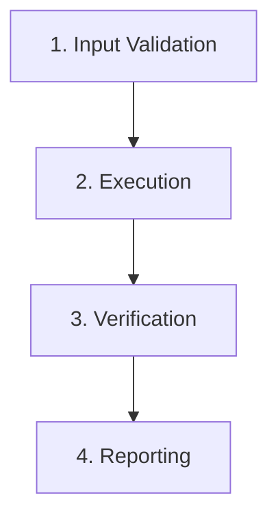

# [Skill Title]

## Overview

[Provide 2-3 concise sentences explaining the purpose, scope, and domain of this skill.]

---

## Core Rules & Principles

1. **Principle 1**: [Description]
2. **Principle 2**: [Description]
3. **Safety & Policy Boundaries**: [Guards, blocked commands, and confirmations]

---

## Intent Classification & Workflow Routing

| Intent | Triggers / Keywords | Target Workflow / Reference |
|:---|:---|:---|
| **ACTION_A** | "trigger word 1", "trigger word 2" | [workflow-a.md](<references/workflows/workflow-a.md>) |
| **ACTION_B** | "trigger word 3", "trigger word 4" | [workflow-b.md](<references/workflows/workflow-b.md>) |

---

## Step-by-Step Procedure



### Step 1: Input Validation
[Details on parameter parsing and safety checks.]

### Step 2: Execution
[Step-by-step guidance.]

### Step 3: Verification
[Commands or automated checks to confirm success.]

### Step 4: Output Delivery
[Expected format of the final response to the user.]

---

## Directory & File Structure

```text
.agents/skills/[skill-name]/
├── SKILL.md
├── scripts/
│   └── helper.js
└── references/
    └── workflows/
```

---

## Error Handling

| Error Condition | Cause | Corrective Action |
|:---|:---|:---|
| `ERR_NOT_FOUND` | Resource does not exist | Prompt user for alternative path |
| `ERR_POLICY_BLOCKED` | Command blocked by policy | Refuse execution and log reason |
