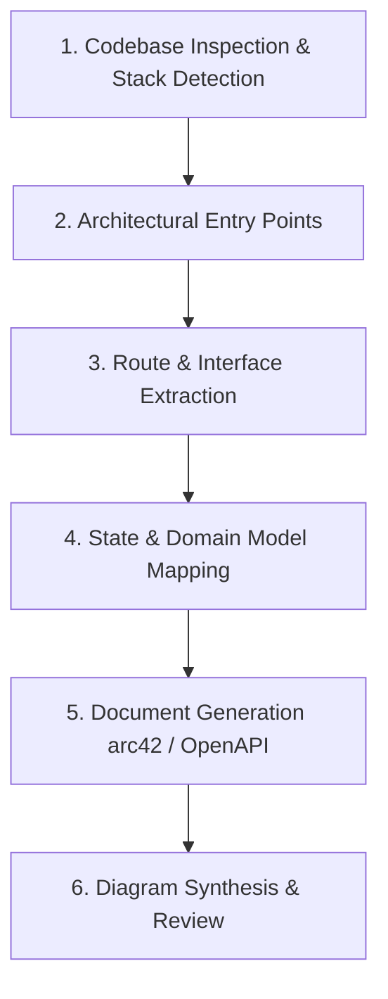

# Brownfield Universal Code-to-Docs Workflow

---
TOKEN_BUDGET: 400
TIER: 2
LOAD_TRIGGER: Intent = CODE_TO_DOCS (documenting existing codebases)
DEPENDENCIES: SKILL.md, references/workflows/brownfield/universal-guide.md
---

## Overview

A language-agnostic, stack-independent workflow for reverse-engineering professional documentation from existing codebases (Node.js/TS, Python, Java, Go, Rust, SPAs, CLI tools, and Agent Skills).

---

## Workflow Steps



### Step 1: Codebase Inspection & Stack Detection
1. Run the built-in inspector tool:
   ```bash
   node scripts/doc-tool.js inspect-codebase [dir]
   ```
2. For stack-specific details, load on demand:
   - Universal / Polyglot: [universal-guide.md](brownfield/universal-guide.md)
   - Node.js / SPA / Zero-Build: [nodejs-spa-guide.md](brownfield/nodejs-spa-guide.md)
   - Spring Boot / Java: [springboot-guide.md](brownfield/springboot-guide.md)
   - FastAPI / Python: [fastapi-guide.md](brownfield/fastapi-guide.md)

### Step 2: 6-Stage Heuristic Extraction

| Stage | Target Focus | Extraction Method |
|:---|:---|:---|
| **2.1 Architecture** | Entry points, system context, boundaries | Read main manifests, server files, app coordinators |
| **2.2 Interfaces** | REST endpoints, RPC, CLI, Web views | Grep route registrations, command parsers, view containers |
| **2.3 Data & State** | Entities, reactive store, DB schemas | Grep schemas, models, reactive store state, cache keys |
| **2.4 Logic Flow** | Primary user journeys, transaction pipelines | Trace handlers -> services -> adapters -> responses |
| **2.5 Security** | Auth, input sanitization, path traversal | Review auth middleware, validators, escape functions |
| **2.6 Deployment** | Runtimes, environment variables, CI/CD | Read `.env.example`, Dockerfiles, package configs |

### Step 3: Document Generation
Select the appropriate document types based on user requirements:
- **Software Design Document (arc42)**: Save to `DESIGN_DOC.md` or `docs/DESIGN_DOC.md`.
- **System Architecture (C4)**: Save to `docs/architecture.md`.
- **API Specification**: Save to `openapi.yaml` or `docs/openapi.yaml`.
- **Agent Skill Spec**: Save to `.agents/skills/<name>/SKILL.md`.

### Step 4: Diagram Generation
Generate native diagrams embedded directly as markdown:
- **Mermaid (Primary)**:
  - C4 Context & Container diagrams
  - Sequence diagrams for primary transactional flows
  - Class or Entity-Relationship (ER) diagrams
  - State machine or flowchart for lifecycle transitions
- **ASCII / PlantUML (Fallback)**:
  - Use ASCII art or PlantUML Salt wireframes only when specialized UI mockups are requested.

### Step 5: Post-Generation Quality Check
1. Validate link integrity and markdown formatting:
   ```bash
   node scripts/doc-tool.js validate [generated-file-or-dir]
   ```
2. Verify all claims in the document cite exact file paths and line numbers as evidence.
