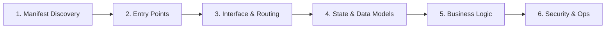

# Universal Code-to-Docs (Brownfield) Guide

---
TOKEN_BUDGET: 380
TIER: 2
LOAD_TRIGGER: Intent = CODE_TO_DOCS on any language, framework, or architecture
DEPENDENCIES: references/workflows/brownfield-workflow.md
---

## Overview

A language-agnostic, stack-independent methodology for reverse-engineering high-quality software documentation (SDD, arc42 DESIGN_DOC, OpenAPI, Architecture Specs) from **any** codebase.

Do not guess or rely on rigid framework-specific assumptions. Follow this universal 6-step heuristic.

---

## The Universal 6-Step Heuristic

### Step 1: Manifest & Tech Stack Discovery
Run the inspector script or search for dependency/configuration manifests:
- CLI command: `node scripts/doc-tool.js inspect-codebase [dir]`
- Manifests to look for:
  - **Node.js / JS / TS**: `package.json`, `tsconfig.json`
  - **Web SPA (Zero-build)**: `index.html`, `assets/js/`
  - **Python**: `pyproject.toml`, `requirements.txt`, `setup.py`
  - **Go**: `go.mod`, `go.sum`
  - **Rust**: `Cargo.toml`
  - **Java / Kotlin**: `pom.xml`, `build.gradle`
  - **PHP**: `composer.json`
  - **C# / .NET**: `*.csproj`, `*.sln`
  - **Agent Ecosystem**: `SKILL.md`, `CLAUDE.md`, `AGENTS.md`, `setting.json`

### Step 2: Architecture & Entry Points
Locate the initialization sequence and top-level lifecycle:
- Web Servers: `server.js`, `main.py`, `main.go`, `src/index.ts`, `Application.java`
- SPAs & Frontend: `index.html`, `app.js`, `main.js`, `src/App.tsx`
- CLI tools: `bin/`, `cli.js`, `cmd/`, `main.rs`
- Agent Workstations: `tools/`, `.agents/skills/`, coordinator entrypoints

### Step 3: Interface & Routing Layer
Identify how external callers or users communicate with the system:
- **HTTP / REST Endpoints**: Search for routing registrations (`app.get(`, `router.post(`, `@app.route(`, `@GetMapping`, `r.GET(`, `http.HandleFunc(`).
- **Client Views & Routes**: Search for view managers, route hashes (`#/diff`, `#/workstation`), DOM container swapping.
- **CLI Commands**: CLI argument parsers (`process.argv`, `argparse`, `cobra`, `clap`).
- **Tool / Agent Interfaces**: Exposed tool definitions, JSON schemas, MCP protocols.

### Step 4: State & Data Models
Discover how data is shaped, validated, and persisted:
- **Database Schemas & ORMs**: SQL schemas, migrations, Prisma, TypeORM, SQLAlchemy, Hibernate entities, GORM structs.
- **Application State**: Reactive stores (`store.js`, Redux, Zustand, Vuex), in-memory registries, cache keys.
- **DTOs / Schemas**: Pydantic models, Zod schemas, JSON schemas, TypeScript interfaces, Go structs.

### Step 5: Core Business Logic & Pipelines
Trace the execution flow from interface to outcome:
- Identify service layers, controller handlers, pipeline coordinators, or worker engines.
- Map the primary user journeys or transaction paths (e.g., Scan -> Compare -> Backup -> Merge -> Commit).
- Document error handling, validation boundaries, and edge cases.

### Step 6: Security, Auth & Deployment Topology
Document environmental constraints and operational boundaries:
- **Authentication & Authorization**: Bearer tokens, JWT, API keys, session cookies, RBAC, input sanitization (`escapeHtml`, path traversal normalization).
- **Environment & Config**: `.env.example`, `setting.json`, configuration loaders.
- **Deployment & Runtime**: Dockerfile, CI/CD pipelines, static CDN deployment, zero-build execution requirements.

---

## Output Target Mapping

| Document Desired | Target File Path | Primary Template |
|:---|:---|:---|
| **Software Design Doc (arc42)** | `DESIGN_DOC.md` | `templates/markdown/DESIGN_DOC.md` |
| **System Architecture Spec** | `docs/architecture.md` | `templates/markdown/architecture.md` |
| **OpenAPI 3.0 / 3.1 Spec** | `openapi.yaml` or `docs/openapi.yaml` | `templates/markdown/api-openapi.yaml` |
| **Agent Skill / Tool Spec** | `.agents/skills/<name>/SKILL.md` | `templates/markdown/agent-skill-spec.md` |
| **Operations Runbook** | `docs/runbooks/<topic>.md` | `templates/markdown/runbook.md` |
