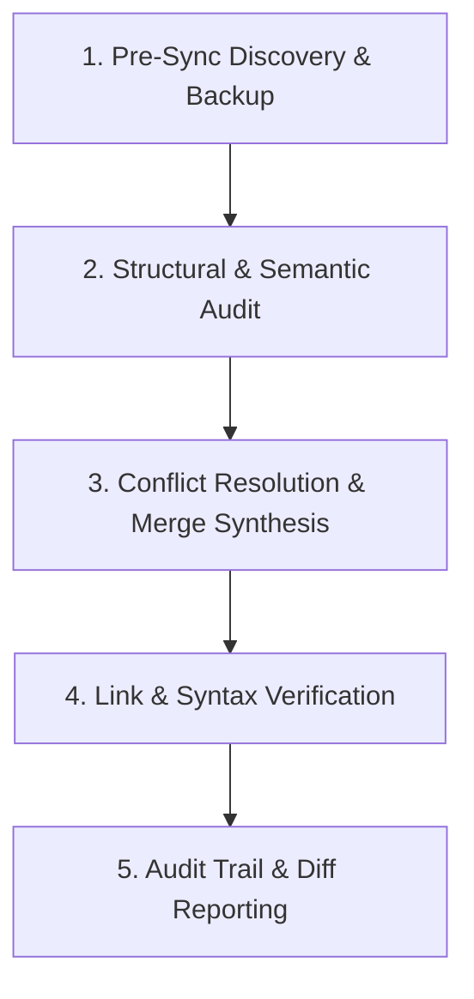

# Documentation Synchronization & Reconciliation Workflow

---
TOKEN_BUDGET: 380
TIER: 2
LOAD_TRIGGER: Intent = SYNC_RECONCILE or comparing/synchronizing docs between Target & Reference
DEPENDENCIES: SKILL.md, references/sync-rules/target-reference-doc-rules.md
---

## Overview

A deterministic 5-phase workflow for auditing, comparing, and synchronizing documentation, specifications, and agent skills between a **Target Workspace** and a **Benchmark Reference**.

Adheres strictly to the SkillSyncPro Target-Reference Synchronization principles.

---

## 5-Phase Synchronization Process



### Phase 1: Pre-Sync Discovery & Backup
1. **Locate Target & Reference Files**: Confirm the source file in Reference and destination file in Target.
2. **Execute Safety Backup**:
   - Verify that Target is backed up in `.skillsync/backups/` or execute a mirror copy before any write operation.
   - Target files must never be modified without an existing rollback target.

### Phase 2: Structural & Semantic Audit
1. **Analyze Document Headings**:
   - Run `node scripts/doc-tool.js audit-sync <targetFile> <refFile>` to extract and compare the heading trees.
2. **Classify Differences**:
   - *Structural Changes*: New sections, omitted headings, reordered chapters.
   - *Content/Logic Updates*: Updated API signatures, bug fixes, algorithmic changes, revised guidelines.
   - *Identity Tokens*: Target project names, repository URLs, author names.

### Phase 3: Conflict Resolution & Merge Synthesis
Apply the three core priority rules:
1. **Structure & Formatting**: Keep Target's headings, table formatting, bullet style, and layout conventions.
2. **Technical Content**: Upgrade Target's descriptions, code samples, parameters, and algorithms to match Reference.
3. **Identity Protection**: Retain Target's project name, paths, and local environment variables. Do not overwrite with Reference's project name.
4. **Surgical Application**: Make minimal edits. Avoid whitespace reformatting outside of modified paragraphs.

### Phase 4: Link & Syntax Verification
1. **Check Relative Links**: Ensure that any newly copied links or references exist relative to the Target's location.
   - Run: `node scripts/doc-tool.js validate <targetFile>`
2. **Verify Code Blocks & Tables**: Ensure closing fences (```` ``` ````) and markdown table pipes are intact.
3. **Check Cross-Agent Compatibility**: Ensure the document is portable across `.agents/`, `.claude/`, and `.github/`.

### Phase 5: Audit Trail & Reporting
Deliver a structured sync report containing:
- **Target File**: Path to modified document.
- **Backup File**: Path to backup created.
- **Sections Preserved**: Local Target sections maintained.
- **Sections Updated / Added**: Logic updated from Reference.
- **Verification Result**: Output of `doc-tool.js validate`.

---

## Quick Reference CLI Commands

```bash
# Compare heading trees and check sync compatibility:
node scripts/doc-tool.js audit-sync path/to/target.md path/to/reference.md

# Validate link integrity and markdown structure after sync:
node scripts/doc-tool.js validate path/to/target.md
```
